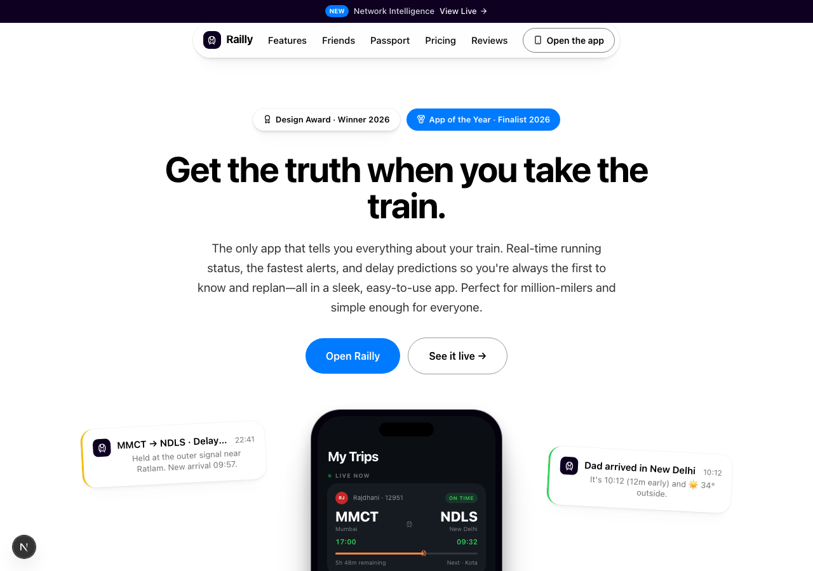
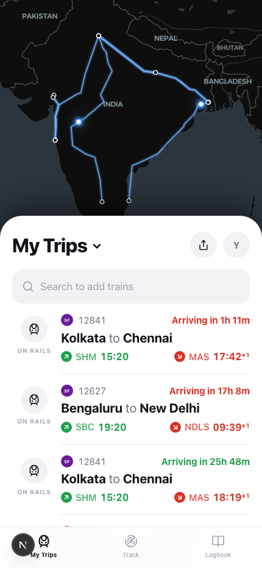
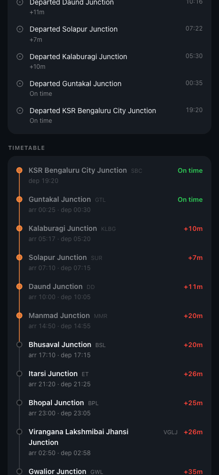
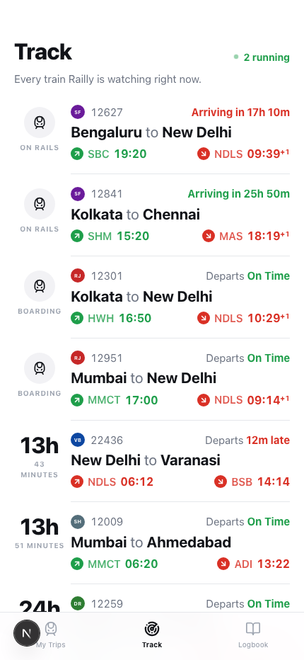
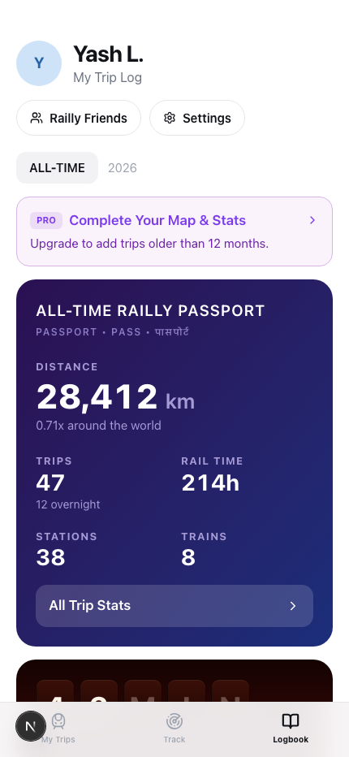
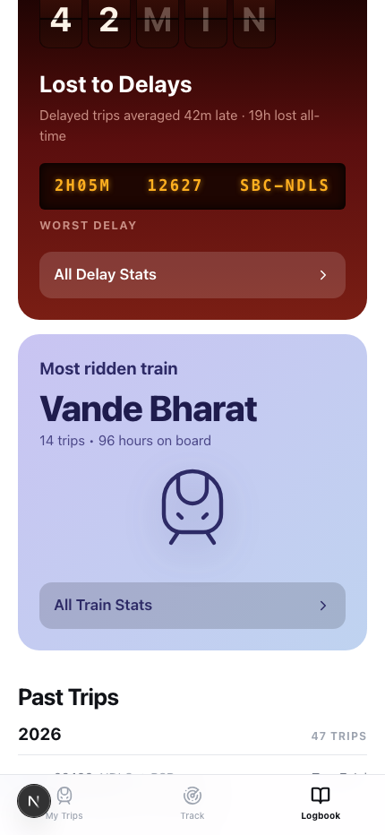

# Railly — the Flighty of train travel 🚆

**Get the truth when you take the train.** Railly reimagines [Flighty](https://flighty.com/) — the Apple Design Award-winning flight tracker — for Indian Railways: live train tracking, delay predictions before the railway announces them, platform-change alerts, and a Passport-style logbook. One codebase ships the flighty.com-style marketing site and a native iOS app whose live network is computed, not fetched.

Built with **Next.js 16 · React 19 · Tailwind CSS 4 · TypeScript (strict)**, plus a **native iOS app (SwiftUI + MapKit)** in [`ios/`](ios/) whose engine is a bit-exact port of the web simulation. No backend, no API keys — see [how the live network works](#how-the-live-network-works).



|  My Trips  |  Trip detail  |  Track  |
| :---: | :---: | :---: |
|  |  |  |

|  Logbook  |  Delay report  |
| :---: | :---: |
|  |  |

## What's inside

**Marketing site (`/`)** — a faithful flighty.com structural clone, re-copywritten for rail: announcement bar, floating pill nav, hero with auto-cycling notification cards orbiting a phone mockup, dark press-quote wall with hover crossfade, alternating feature journey, Friends, Passport teaser, a dark "Network Intelligence" live board, masonry testimonial wall, INR pricing, and the full footer. Scroll reveals respect `prefers-reduced-motion`.

**The app** is the native iOS app in [`ios/`](ios/) — the Dec 2025 Flighty design language (studied from 119 real iOS screenshots), applied to trains: My Trips over a live network map, trip detail with the flown route solid and the rest dashed, a one-line-per-train Track board, and a Passport-style Logbook with a CSS split-flap delay board. The web app that used to live at `/app` was removed — the site is the marketing page; the product is the iOS app.

## How the live network works

There is no backend. Eight real Indian Railways services (Mumbai & Howrah Rajdhani, two Vande Bharats, Shatabdi, Duronto, Coromandel and Karnataka Express) carry researched public timetables with station coordinates in [`src/lib/trains.ts`](src/lib/trains.ts).

The simulation ([`src/lib/sim.ts`](src/lib/sim.ts)) makes the network a **pure function of (train, date, time)**: per-run delays are a seeded random walk over the timetable (with occasional incident jolts and recoveries), positions interpolate along the route between stops, and the event feed — departures, delay explanations, platform changes — derives from the same seed. Every client on Earth renders the identical "live" network, it evolves in real time, and premium trains are measurably more punctual than the humble Superfast, just like real life.

Departures are staggered 06:00–19:20 IST across 6–38 h journeys, so something is always running.

**Native iOS app ([`ios/`](ios/))** — SwiftUI + MapKit, iOS 17+. The simulation engine is a bit-exact Swift port (same seeded PRNG, same IST math): at any instant the iPhone app and the web app show the identical live network. `open ios/Railly.xcodeproj` in Xcode 16+ and run. Details in [`ios/README.md`](ios/README.md).

## Getting started

```bash
npm install
npm run dev     # http://localhost:3000
```

`npm run build` produces the production build; `npx eslint .` lints (Next 16 removed `next lint`).

## Project structure

```
src/
  app/
    page.tsx              marketing landing page
  components/
    marketing/            hero orbit, press wall, live network canvas, pricing…
  lib/
    trains.ts sim.ts      the deterministic live-network simulation
ios/                      the native SwiftUI app (see ios/README.md)
```

Tokens live in [`src/app/globals.css`](src/app/globals.css). The marketing site follows a Flighty style reference: white "departure board" canvas, `#0d0021` violet "control room" sections, exactly two chromatic signals (action blue `#007bff`, conversion amber `#f7be00`). The app follows the Dec 2025 Flighty iOS release: white sheets over a dark map, `#f2f2f5` fills and hairline dividers, status green `#1e9e4a` / red `#d93025` owning entire time clusters, amber `#f6c445` platform chips, iOS blue actions, Pro purple `#7c3aed` — system-ui type, tabular numerals everywhere, uppercase micro-labels.

---

*A design-study demo. Not affiliated with Indian Railways or Flighty; timetables are approximations and lifetime stats are illustrative.*
