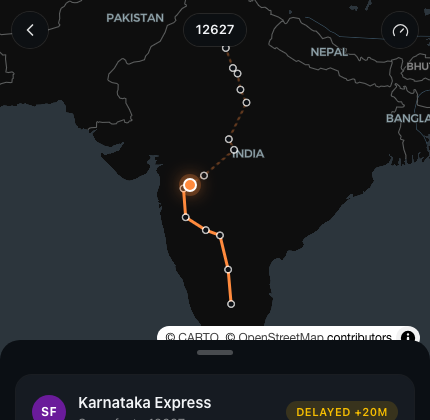

# Railly — the Flighty of train travel 🚆

**Get the truth when you take the train.** Railly reimagines [Flighty](https://flighty.com/) — the Apple Design Award-winning flight tracker — for Indian Railways: live train tracking, delay predictions before the railway announces them, platform-change alerts, and a Passport-style logbook. One codebase ships both the flighty.com-style marketing site and the app itself.

Built with **Next.js 16 · React 19 · Tailwind CSS 4 · MapLibre GL · TypeScript (strict)**. No backend, no API keys — see [how the live network works](#how-the-live-network-works).

|  The departure board  |  The control room  |
| :---: | :---: |
|  |  |

|  My Trips  |  Trip detail  |  Track  |
| :---: | :---: | :---: |
|  |  |  |

## What's inside

**Marketing site (`/`)** — a faithful flighty.com structural clone, re-copywritten for rail: announcement bar, floating pill nav, hero with auto-cycling notification cards orbiting a phone mockup, dark press-quote wall with hover crossfade, alternating feature journey, Friends, Passport teaser, a dark "Network Intelligence" live board, masonry testimonial wall, INR pricing, and the full footer. Scroll reveals respect `prefers-reduced-motion`.

**The app (`/app`)** — Flighty's design language, applied to trains:

- **My Trips** — one dense departure-board card per journey: big station codes, struck-through late times (green = on time, red = late), tinted status pills, and a live progress bar with the train glyph riding the fill edge. Journeys group into *Live now · date headers · Past*.
- **Trip detail** (`/app/trip/[id]`) — dark MapLibre map with the flown route solid orange, the remainder dashed and dimmed, and a glowing live marker; then a sheet of cards: status header, departure/arrival blocks (platform is the hero datum), live progress (km covered / speed / time to go), a delay-explanation **Updates feed** ("Held at the outer signal… +9m near Manmad"), full station timeline, 60-day arrival forecast, rake details, booking, and good-to-know.
- **Track** (`/app/track`) — the whole network as a one-line-per-train live board.
- **Logbook** (`/app/logbook`) — Passport-style lifetime stats: big-number tiles, top trains, and the annual delay report.

## How the live network works

There is no backend. Eight real Indian Railways services (Mumbai & Howrah Rajdhani, two Vande Bharats, Shatabdi, Duronto, Coromandel and Karnataka Express) carry researched public timetables with station coordinates in [`src/lib/trains.ts`](src/lib/trains.ts).

The simulation ([`src/lib/sim.ts`](src/lib/sim.ts)) makes the network a **pure function of (train, date, time)**: per-run delays are a seeded random walk over the timetable (with occasional incident jolts and recoveries), positions interpolate along the route between stops, and the event feed — departures, delay explanations, platform changes — derives from the same seed. Every client on Earth renders the identical "live" network, it evolves in real time, and premium trains are measurably more punctual than the humble Superfast, just like real life.

Departures are staggered 06:00–19:20 IST across 6–38 h journeys, so something is always running.

## Getting started

```bash
npm install
npm run dev     # http://localhost:3000  (site) · /app (the app)
```

`npm run build` produces the production build; `npx eslint .` lints (Next 16 removed `next lint`).

## Project structure

```
src/
  app/
    page.tsx              marketing landing page
    app/                  the Railly app (dark, phone-column shell)
      page.tsx            My Trips
      trip/[id]/          live trip detail + map
      track/              network board
      logbook/            Passport-style stats
  components/
    marketing/            hero orbit, press wall, feature journey, pricing…
    app/                  trip cards, live map, status pills, tab bar…
  lib/
    trains.ts             researched timetables + coordinates
    sim.ts                deterministic live-network engine
    trips.ts              the demo persona's tickets, derived live
    geo.ts · rng.ts · time.ts · format.ts · types.ts
```

## Design system

Tokens live in [`src/app/globals.css`](src/app/globals.css), transcribed from a Flighty style reference: a white "departure board" canvas and a `#0d0021` violet "control room", with exactly two chromatic signals (action blue `#007bff`, conversion amber `#f7be00`) plus functional status colors. The app itself runs on Flighty's cockpit palette — cool charcoal surfaces with one warm orange accent — system-ui type, tabular numerals for every time, and uppercase micro-labels.

---

*A design-study demo. Not affiliated with Indian Railways or Flighty; timetables are approximations and lifetime stats are illustrative.*
